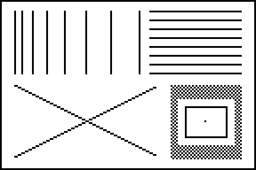
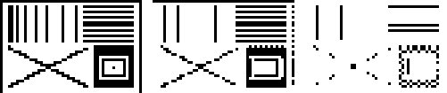

# macpaint-algorithms

Reverse-engineering notes on MacPaint's bitmap algorithms.

## MacPaint 2.0 selection scaling

**[docs/macpaint2-scaling.md](docs/macpaint2-scaling.md)**: how *Scale
Selection…* and stretch-dragging keep black pixels when shrinking.

In short, MacPaint 2.0 (Claris, 1987) only computes a new rectangle. The pixels
are resampled by QuickDraw's `CopyBits`, whose 1-bit shrink loops OR together
every source pixel that lands on a destination pixel, so black wins. Each
rescale also starts again from the selection's original pixels.

The write-up also decodes an ink-weighting shrink loop that sits in QuickDraw's
`Stretch.a` but is switched off with `IF 0`. It preserves gray density, but it
rations, drifts and even erases thin lines, which may be why the OR loop
stayed.

| Original | 37%: shipped OR shrink · disabled ink-weighting loop · nearest-neighbour |
|---|---|
|  |  |

## Layout

| Path | What |
|---|---|
| `docs/` | Write-up and comparison images |
| `qdscale/` | Python model of QuickDraw's 1-bit stretch and of `SCALESEL` |
| `tests/` | Unit tests for the model |
| `tools/extract_rsrc.py` | Dump a resource fork (raw or AppleDouble) to files |
| `tools/m68kdis.py` | 68000 disassembler for `CODE` resources, with MacsBug symbols, jump-table resolution and trap names (needs `capstone`) |

```
python3 -m unittest discover -s tests -t .
python3 -m qdscale.demo docs/images
```

No Apple or Claris code or binaries are included. To regenerate the
disassembly, supply your own copy of the application. See section 1 of the
write-up.
